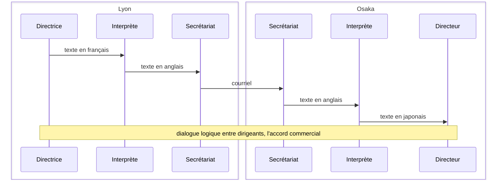
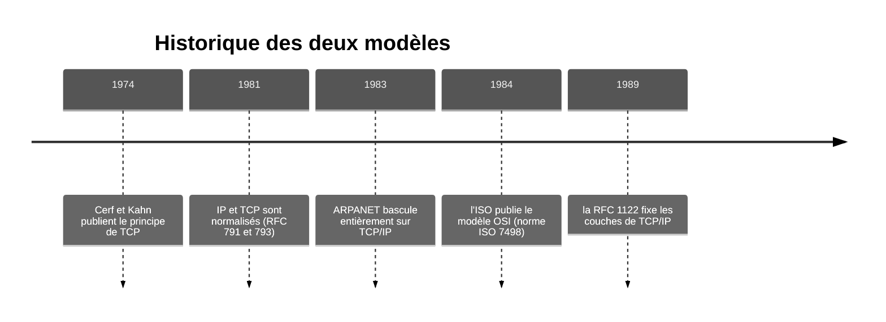

[Sommaire](Readme.md) · [Chapitre suivant →](02-Le-modele-OSI.md)

# Pourquoi un modèle en couches ?

## 🎯 Objectifs du chapitre

À la fin de ce chapitre, vous saurez :

1. Expliquer le problème que les modèles en couches résolvent.
2. Distinguer un **protocole** d'un **service**.
3. Situer les modèles OSI et TCP/IP dans leur histoire, et dire à quoi sert chacun aujourd'hui.

---

## 1. Le problème de l'interopérabilité

Ouvrir une page web fait intervenir de nombreux matériels et logiciels : un
portable sous Windows, une borne Wi-Fi, un switch, un routeur, des liaisons
fibre, un serveur sous Linux. Ces équipements viennent de constructeurs
différents et fonctionnent ensemble parce qu'ils respectent les mêmes normes.

Dans les années 1970, chaque constructeur avait sa propre architecture réseau
(SNA chez IBM, DECnet chez Digital). Deux machines de marques différentes ne
pouvaient pas communiquer. Il fallait des **règles communes** et publiques, que
tous les constructeurs puissent implémenter.

Une norme unique qui couvrirait tout, de la tension électrique sur un câble
jusqu'au format d'un courriel, serait impossible à maintenir. La solution
retenue consiste à **découper le problème en couches**.

---

## 2. Diviser pour régner

Un modèle en couches répartit le travail de communication en niveaux
superposés. Chaque couche :

- a **une mission précise** (transmettre des bits, trouver un chemin, garantir
  la livraison, etc.) ;
- **rend un service** à la couche du dessus, sans que celle-ci ait à savoir
  comment il est rendu ;
- **utilise le service** de la couche du dessous ;
- **dialogue avec la couche de même niveau** sur la machine distante, selon des
  règles appelées **protocole**.

Pour un administrateur, ce découpage a plusieurs avantages :

| Avantage | Conséquence pratique |
|---|---|
| Indépendance | On remplace le Wi-Fi par un câble Ethernet sans modifier le navigateur. |
| Interopérabilité | Un switch Cisco et un switch HPE respectent la même norme Ethernet et fonctionnent ensemble. |
| Dépannage méthodique | On vérifie les couches une par une. |
| Vocabulaire commun | Dire "problème de couche 2" suffit à situer un incident. |

---

## 3. Une analogie : la directrice, l'interprète et le secrétariat

Une directrice à Lyon veut conclure un accord avec un directeur à Osaka. Elle ne
parle pas japonais, il ne parle pas français. Chacun s'appuie sur deux
intermédiaires :

Cet exemple illustre trois principes des réseaux :

1. **Chaque niveau a son propre protocole.** Les dirigeants négocient un accord,
   les interprètes utilisent une langue commune (l'anglais), les secrétariats un
   moyen d'envoi (le courriel).
2. **Chaque niveau ignore le détail des autres.** La directrice ne sait pas si
   la proposition part par courriel ou par coursier. Le secrétariat ne lit pas
   le contenu de l'accord.
3. **Seul le niveau le plus bas transmet réellement les données.** Les
   dialogues des niveaux supérieurs sont *logiques* : les messages descendent
   la chaîne d'un côté et la remontent de l'autre.

Dans un réseau, le secrétariat correspond à la **carte réseau**, l'interprète à
**TCP/IP** et la directrice au **navigateur**.

---

## 4. Protocole et service

| Terme | Relation | Exemple |
|---|---|---|
| **Protocole** | *horizontale* : entre deux couches de même niveau, sur deux machines différentes | HTTP entre le navigateur et le serveur web |
| **Service** | *verticale* : entre deux couches voisines, sur la même machine | TCP offre à HTTP un transport fiable |

Un protocole définit le **format** des messages échangés, leur **ordre** et la
**réaction** attendue à chacun. Deux logiciels écrits par des éditeurs
différents peuvent communiquer s'ils respectent le même protocole.

---

## 5. Historique des deux modèles

Deux modèles en couches sont utilisés aujourd'hui.

- **TCP/IP** a été construit à partir de protocoles déjà implémentés et
  déployés sur ARPANET, l'ancêtre d'Internet. Le modèle a été décrit après
  coup. Ses normes, les **RFC**, sont publiées gratuitement par l'IETF. C'est
  la pile de protocoles utilisée sur Internet et dans les réseaux d'entreprise.
- **OSI** (*Open Systems Interconnection*) est un modèle de référence en sept
  couches, normalisé par l'ISO avant d'être implémenté. Ses protocoles ont été
  peu adoptés, mais son **découpage** et son **vocabulaire** sont devenus la
  référence.

> **À retenir :** OSI sert de modèle de référence pour décrire les réseaux,
> TCP/IP est la pile de protocoles réellement utilisée. L'expression "couche 3"
> fait référence à la numérotation OSI, même quand le protocole concerné est IP.

Le réseau français **Cyclades**, conçu au début des années 1970 par Louis
Pouzin, a introduit le principe du *datagramme* repris par IP. L'ingénieur
Hubert Zimmermann, membre de cette équipe, a ensuite largement contribué à la
rédaction du modèle OSI.

---

## Vérifier sa compréhension

1. Vous remplacez la carte Wi-Fi d'un portable par un adaptateur Ethernet USB.
   Faut-il réinstaller le navigateur ? Pourquoi ?
2. Entre un client de messagerie et le serveur de messagerie, SMTP est-il un
   protocole ou un service ?

Voir la correction

1. Non. Le changement concerne les couches basses (physique et liaison). Le
   navigateur utilise les services des couches intermédiaires sans dépendre du
   support utilisé.
2. Un protocole : SMTP régit le dialogue *horizontal* entre deux programmes de
   même niveau, sur deux machines différentes.

---

[Sommaire](Readme.md) · [Chapitre suivant →](02-Le-modele-OSI.md)
