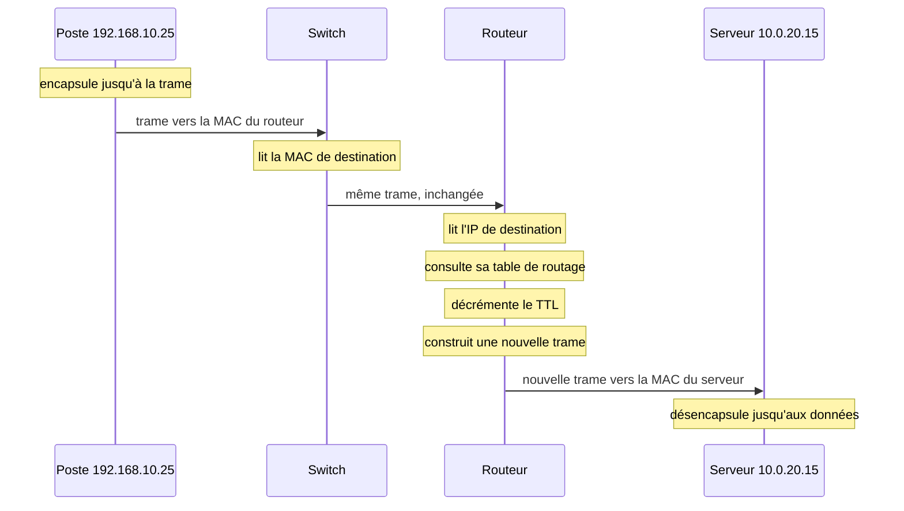
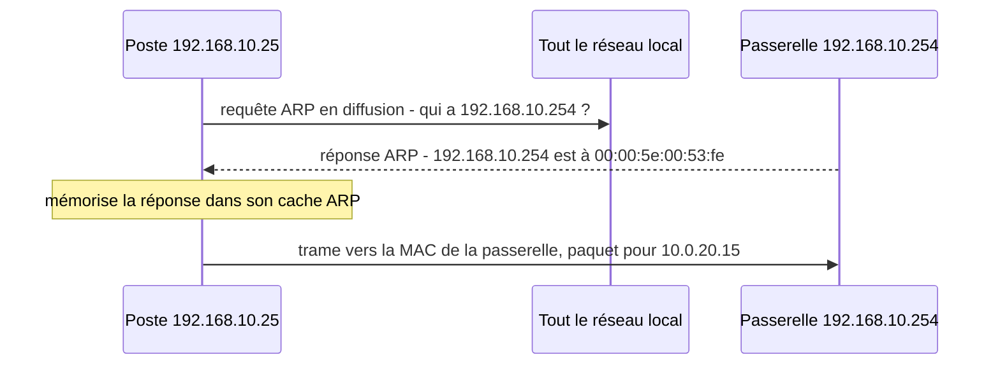

[← Chapitre précédent](02-Le-modele-OSI.md) · [Sommaire](Readme.md) · [Chapitre suivant →](04-Le-modele-TCP-IP.md)

# L'encapsulation : le trajet d'une donnée

## 🎯 Objectifs du chapitre

À la fin de ce chapitre, vous saurez :

1. Expliquer l'encapsulation et la désencapsulation.
2. Nommer l'unité de données à chaque étape : données, segment, paquet, trame, bits.
3. Dire ce que lit et ce que modifie un switch, puis un routeur, au passage d'une donnée.
4. Expliquer le rôle d'ARP et de la passerelle par défaut.
5. Reconnaître les couches dans une capture Wireshark.

---

## 1. Le fil rouge

Ce chapitre s'appuie sur l'exemple suivant :

> Un poste de l'accueil, `192.168.10.25`, ouvre `https://intranet.example.com`.
> Le serveur intranet, `10.0.20.15`, se trouve dans le réseau des serveurs. Un
> switch relie le poste au routeur, qui relie les deux réseaux.

| Machine | Adresse IP | Adresse MAC |
|---|---|---|
| Poste de l'accueil | `192.168.10.25` | `00:00:5e:00:53:25` |
| Routeur, interface côté postes (la passerelle) | `192.168.10.254` | `00:00:5e:00:53:fe` |
| Routeur, interface côté serveurs | `10.0.20.254` | `00:00:5e:00:53:01` |
| Serveur intranet | `10.0.20.15` | `00:00:5e:00:53:15` |

---

## 2. Encapsuler : chaque couche ajoute son en-tête

À l'émission, la donnée **descend** les couches. Chacune ajoute devant elle un
**en-tête** (*header*) qui contient les informations dont la couche de même
niveau aura besoin à l'arrivée. La couche 2 ajoute aussi une **queue**
(*trailer*), le FCS, qui permet de détecter une trame endommagée.

<center>


</center>

| Couche | Ce qu'elle ajoute | Ce que contient l'en-tête (extrait) | Nouvelle PDU |
|---|---|---|---|
| 7 Application | la requête elle-même | `GET /` vers `intranet.example.com` | données |
| 4 Transport | en-tête TCP (20 octets minimum) | port source `51234`, port destination `443`, numéros de séquence | segment |
| 3 Réseau | en-tête IP (20 octets minimum en IPv4) | IP source `192.168.10.25`, IP destination `10.0.20.15`, TTL | paquet |
| 2 Liaison | en-tête Ethernet (14 octets) et FCS (4 octets) | MAC source, MAC destination, type de contenu | trame |
| 1 Physique | rien, elle convertit les bits en signal | aucun en-tête | bits |

À la réception, l'opération inverse s'appelle la **désencapsulation** : chaque
couche lit son en-tête, le retire et transmet le reste à la couche supérieure.
Une couche ne lit que son propre en-tête, ce qui rend les couches
indépendantes.

> **Analogie :** une lettre est mise dans une enveloppe, l'enveloppe dans un
> colis, le colis dans un camion. Chaque intermédiaire ne lit que l'étiquette
> qui le concerne.

---

## 3. Le trajet : qui lit quoi ?

Les équipements traversés n'ont pas besoin de remonter les sept couches. Chacun
désencapsule **jusqu'à la couche dont il a besoin**, prend sa décision, puis
réencapsule et transmet.

<center>


</center>



### Ce qui change à chaque routeur

| Champ | Du poste au routeur | Du routeur au serveur |
|---|---|---|
| MAC source | poste `…:53:25` | routeur, côté serveurs `…:53:01` |
| MAC destination | routeur, côté postes `…:53:fe` | serveur `…:53:15` |
| IP source | `192.168.10.25` | `192.168.10.25` |
| IP destination | `10.0.20.15` | `10.0.20.15` |
| Port destination | `443` | `443` |
| TTL | `128` | `127` |

À retenir :

- les **adresses MAC** sont **réécrites à chaque routeur** : elles ne sont
  valables que sur un réseau local ;
- les **adresses IP** restent **les mêmes de bout en bout** ;
- le **TTL** diminue de 1 à chaque routeur (valeur initiale : 128 sous Windows,
  64 sous Linux).

Exception : la box ou le pare-feu qui relie l'entreprise à Internet effectue en
général une **traduction d'adresses (NAT)**. Il remplace l'adresse IP source
privée par son adresse publique.

---

## 4. ARP : comment le poste trouve la bonne adresse MAC

Le poste connaît l'adresse IP du serveur, mais il a besoin d'une adresse MAC
pour construire la trame. Il procède ainsi :

1. Grâce à son **masque de sous-réseau**, il constate que `10.0.20.15` n'est
   **pas dans son réseau local**.
2. Il doit donc passer par sa **passerelle par défaut**, `192.168.10.254`.
3. Il demande l'adresse MAC de cette passerelle avec **ARP** (*Address
   Resolution Protocol*).



La requête ARP est envoyée en **diffusion** (`ff:ff:ff:ff:ff:ff`) : tous les
équipements du réseau local la reçoivent, seul le propriétaire de l'adresse
répond. La réponse est conservée dans le **cache ARP**, visible avec `arp -a`
sous Windows ou `ip neigh` sous Linux.

ARP fait le lien entre la couche 3 (l'adresse IP connue) et la couche 2
(l'adresse MAC nécessaire). On le classe souvent en "couche 2,5".

---

## 5. Ce que montre Wireshark

Wireshark, l'analyseur de trames le plus utilisé, affiche chaque trame capturée
**couche par couche, de bas en haut**, dans l'ordre de la désencapsulation.
Voici la première requête HTTPS du poste :

```text
Frame 42: 571 bytes on wire (4568 bits), 571 bytes captured (4568 bits) on interface eth0
Ethernet II, Src: 00:00:5e:00:53:25, Dst: 00:00:5e:00:53:fe
Internet Protocol Version 4, Src: 192.168.10.25, Dst: 10.0.20.15
Transmission Control Protocol, Src Port: 51234, Dst Port: 443, Seq: 1, Ack: 1, Len: 517
Transport Layer Security
```

| Ligne Wireshark | Couche | Informations |
|---|---|---|
| `Frame` | 1 | la trame reçue sur l'interface : 571 octets |
| `Ethernet II` | 2 | les adresses MAC : la destination est la passerelle, pas le serveur |
| `Internet Protocol Version 4` | 3 | les adresses IP de bout en bout |
| `Transmission Control Protocol` | 4 | les ports, et 517 octets de données transportées |
| `Transport Layer Security` | 6-7 | le début d'une session chiffrée HTTPS |

Taille totale : 14 octets d'en-tête Ethernet + 20 d'IP + 20 de TCP + 517 de
données = 571 octets.

---

## Vérifier sa compréhension

1. Le poste envoie un paquet avec un TTL de 128. Il traverse trois routeurs
   avant d'atteindre le serveur. Quel TTL le serveur lit-il ?
2. Dans une capture prise sur le poste, un paquet destiné à `10.0.20.15` porte
   la MAC de destination `00:00:5e:00:53:fe`. Est-ce une erreur ?
3. Un switch doit-il lire l'adresse IP pour transmettre une trame ?

<details>
<summary>Voir la correction</summary>

1. 125 : chaque routeur retire 1 au TTL.
2. Non. Le serveur est dans un autre réseau : la trame est donc adressée à la
   passerelle (le routeur). Le serveur est désigné par l'adresse **IP** de
   destination.
3. Non. Un switch travaille en couche 2 : l'adresse MAC de destination lui
   suffit. Seuls les switchs dits "de niveau 3" lisent aussi l'IP, parce qu'ils
   assurent en plus une fonction de routage.

</details>

---

[← Chapitre précédent](02-Le-modele-OSI.md) · [Sommaire](Readme.md) · [Chapitre suivant →](04-Le-modele-TCP-IP.md)
