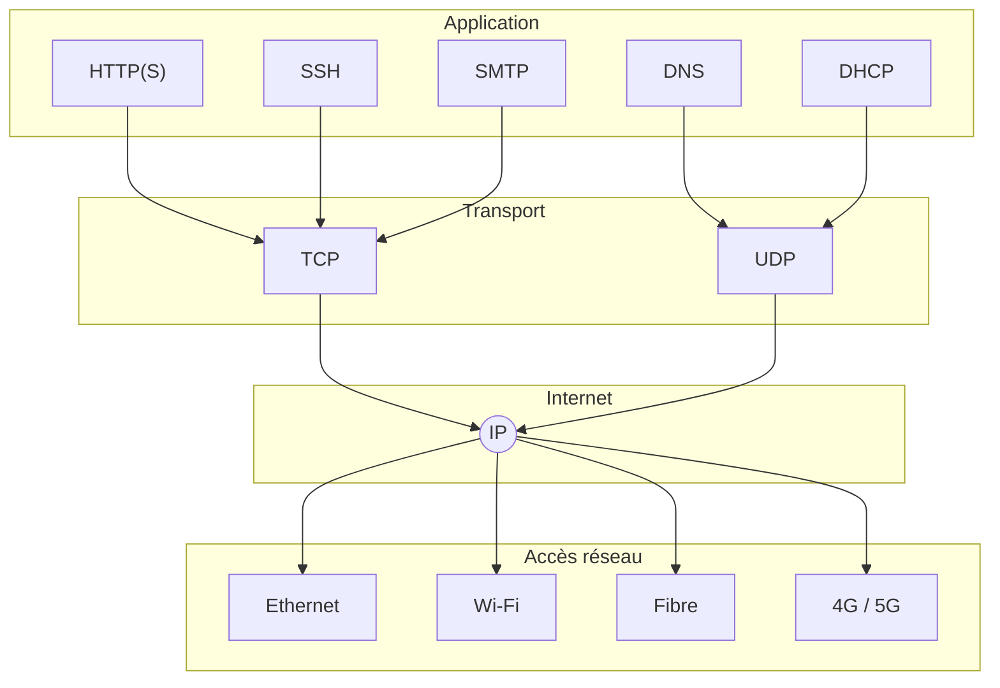
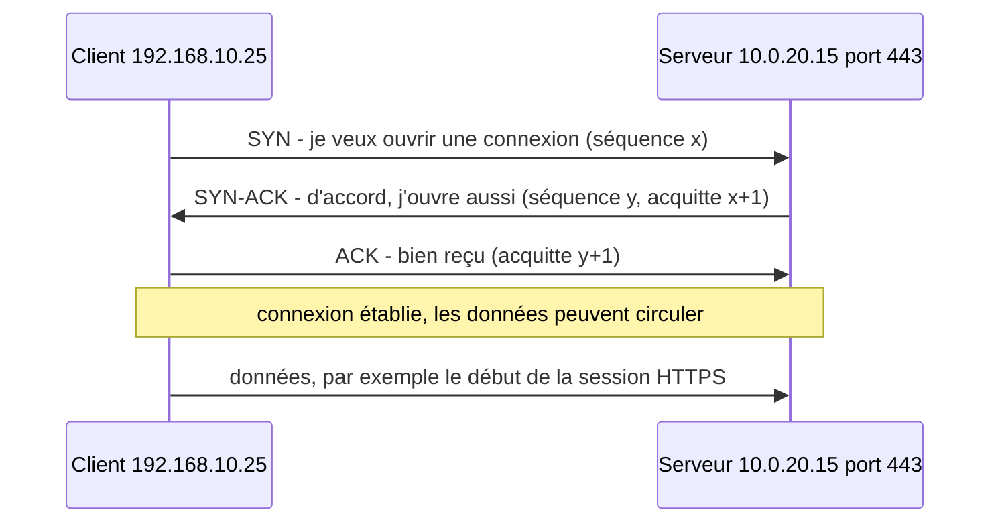

[← Chapitre précédent](03-L-encapsulation.md) · [Sommaire](Readme.md) · [Chapitre suivant →](05-Diagnostiquer-et-securiser.md)

# Le modèle TCP/IP

## 🎯 Objectifs du chapitre

À la fin de ce chapitre, vous saurez :

1. Nommer les quatre couches du modèle TCP/IP et les faire correspondre à OSI.
2. Expliquer pourquoi IP est le point de passage obligé de tous les échanges.
3. Choisir entre TCP et UDP, et justifier ce choix.
4. Décrire l'ouverture d'une connexion TCP.
5. Associer les services courants à leur port.

---

## 1. Quatre couches au lieu de sept

Le modèle TCP/IP, décrit dans la RFC 1122, compte **quatre couches**. Elles
couvrent les sept couches d'OSI, avec deux regroupements.

| Couche TCP/IP | Couches OSI | Rôle | Protocoles |
|---|---|---|---|
| **Application** | 7, 6, 5 | tout ce qui concerne l'application, y compris le format et la session | HTTP, DNS, DHCP, SMTP, SSH, TLS |
| **Transport** | 4 | acheminement de bout en bout, entre programmes | TCP, UDP |
| **Internet** | 3 | adressage logique et routage entre réseaux | IPv4, IPv6, ICMP |
| **Accès réseau** | 2, 1 | transmission sur le support local | Ethernet, Wi-Fi, ARP |

Explication des regroupements :

- **en haut**, les fonctions de session et de présentation sont prises en
  charge par les applications (chapitre 2) ;
- **en bas**, TCP/IP ne définit pas de norme pour le support physique. Il
  utilise les technologies existantes (Ethernet, Wi-Fi, fibre, 4G), normalisées
  par d'autres organismes comme l'IEEE.

> **Modèle à 5 couches :** de nombreux manuels et formations présentent TCP/IP
> en cinq couches, en séparant la couche Accès réseau en **Liaison** et
> **Physique**.

---

## 2. Le sablier : tout passe par IP

Au-dessus d'IP se trouvent de nombreuses applications, au-dessous de nombreux
supports physiques. Entre les deux, **un seul protocole** : IP. C'est pourquoi
TCP/IP est souvent représenté sous la forme d'un sablier.

Une nouvelle application fonctionne sur tous les réseaux dès qu'elle utilise
IP. Une nouvelle technologie d'accès sert toutes les applications dès qu'elle
sait transporter IP.

---

## 3. TCP ou UDP ?

La couche Transport propose deux protocoles, adaptés à des besoins différents.

| Critère | TCP | UDP |
|---|---|---|
| Connexion | ouverte avant l'échange, fermée après | aucune : les données sont envoyées directement |
| Fiabilité | accusés de réception, retransmission des pertes | aucune garantie de livraison |
| Ordre | données remises dans l'ordre | ordre non garanti |
| Contrôle de flux | adapte le débit au destinataire et au réseau | aucun |
| En-tête | 20 octets minimum | 8 octets |
| Point fort | l'intégrité des données | la rapidité, la légèreté |
| Usages | web, courriel, SSH, transfert de fichiers, RDP | DNS, DHCP, NTP, voix sur IP, visio, jeux, streaming |

Le choix dépend de l'application : une donnée qui arrive en retard est-elle
encore utile ?

- Un fichier téléchargé doit arriver **complet** : un octet manquant le rend
  inutilisable. → TCP.
- Dans un appel vidéo, une image arrivée **en retard** est inutile :
  l'application passe à la suivante. → UDP.

---

## 4. La poignée de main TCP

Avant tout échange de données, TCP ouvre la connexion en **trois étapes**
(*three-way handshake*) :

Conséquences pratiques :

- Si le serveur répond `SYN-ACK`, **le port est ouvert** et un service écoute.
  S'il répond par un `RST` (*reset*), le port est fermé. S'il ne répond pas, un
  pare-feu filtre probablement le trafic. C'est ce que vérifient
  `Test-NetConnection` et `nc` (chapitre 5).
- Un attaquant qui envoie des milliers de `SYN` sans terminer la poignée de
  main épuise les ressources du serveur : c'est l'attaque par **SYN flood**
  (chapitre 5).

La fermeture se fait par un échange de `FIN` et d'`ACK` dans chaque sens.

---

## 5. Les ports courants

L'IANA répartit les ports en trois plages : **0 à 1023**, les ports *bien
connus* des services standard ; **1024 à 49151**, les ports *enregistrés* ;
**49152 à 65535**, les ports *dynamiques*, attribués aux clients.

| Port | Protocole | Transport | Service |
|---|---|---|---|
| 20, 21 | FTP | TCP | transfert de fichiers (non chiffré) |
| 22 | SSH | TCP | administration à distance chiffrée, SFTP |
| 23 | Telnet | TCP | administration à distance **non chiffrée**, à proscrire |
| 25 | SMTP | TCP | envoi de courriel entre serveurs |
| 53 | DNS | UDP (et TCP) | résolution de noms |
| 67, 68 | DHCP | UDP | attribution automatique d'adresses IP |
| 80 | HTTP | TCP | web non chiffré |
| 123 | NTP | UDP | synchronisation de l'heure |
| 143 | IMAP | TCP | consultation de courriel |
| 161 | SNMP | UDP | supervision des équipements |
| 389 | LDAP | TCP | annuaire (Active Directory) |
| 443 | HTTPS | TCP (et UDP pour HTTP/3) | web chiffré |
| 445 | SMB | TCP | partage de fichiers Windows |
| 3389 | RDP | TCP | bureau à distance Windows |

Le client utilise un port dynamique : dans la capture du chapitre 3, le poste
émet depuis son port `51234` vers le port `443` du serveur.

---

## Vérifier sa compréhension

1. Quelles couches OSI la couche Application de TCP/IP regroupe-t-elle ?
2. Un service de visioconférence doit-il plutôt utiliser TCP ou UDP ? Et un
   serveur de fichiers ?
3. Pourquoi le DNS utilise-t-il UDP pour ses requêtes ordinaires ?

Voir la correction

1. Les couches 7 (Application), 6 (Présentation) et 5 (Session).
2. La visioconférence utilise plutôt UDP : une image en retard est inutile, la
   fluidité prime. Le serveur de fichiers utilise TCP : le fichier doit arriver
   complet et intact.
3. Une requête DNS et sa réponse tiennent en général chacune dans un seul
   datagramme. Ouvrir une connexion TCP pour un seul échange serait plus
   coûteux que l'échange lui-même. En cas de perte, le client renvoie la
   requête. Le DNS utilise TCP pour les réponses volumineuses et les transferts
   de zone.

---

[← Chapitre précédent](03-L-encapsulation.md) · [Sommaire](Readme.md) · [Chapitre suivant →](05-Diagnostiquer-et-securiser.md)
