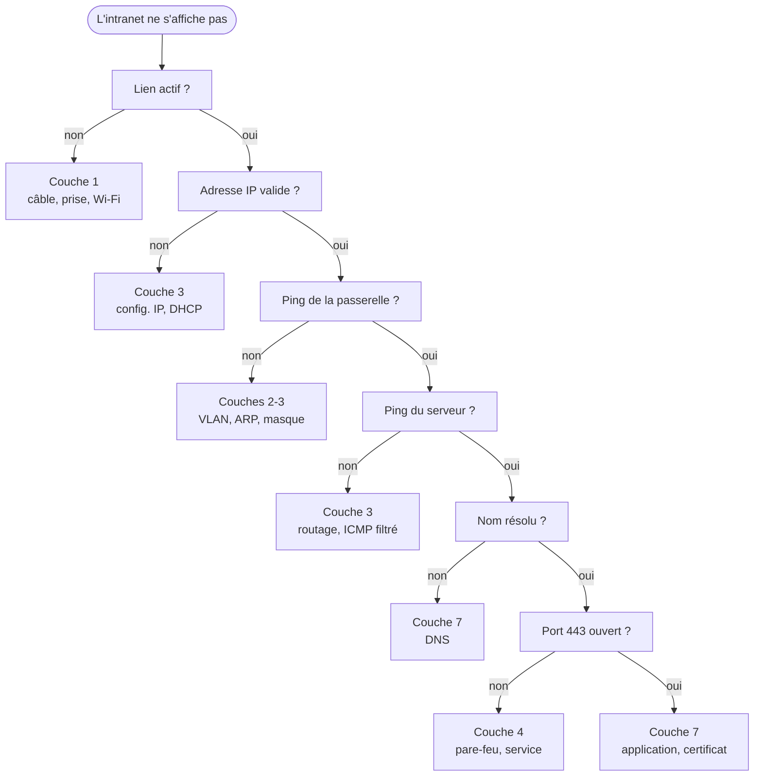

[← Chapitre précédent](04-Le-modele-TCP-IP.md) · [Sommaire](Readme.md) · [Annexe : glossaire →](A-Glossaire.md)

# Diagnostiquer et sécuriser couche par couche

## 🎯 Objectifs du chapitre

À la fin de ce chapitre, vous saurez :

1. Mener un diagnostic réseau méthodique, une couche après l'autre.
2. Choisir, sous Windows comme sous Linux, la commande qui vérifie chaque couche.
3. Associer à chaque couche des attaques typiques et leurs contre-mesures.
4. Dire à quelle couche filtre un pare-feu donné.

---

## 1. La méthode : une couche après l'autre

Le modèle en couches fournit une méthode de dépannage : **vérifier chaque
couche avant de passer à la suivante**, en partant du bas. Une couche ne peut
fonctionner que si les couches inférieures fonctionnent.

Exemple repris du chapitre 3 : le poste `192.168.10.25` n'arrive plus à ouvrir
`https://intranet.example.com`.



À noter :

- **`ping` teste les couches 1 à 3 en une seule commande.** S'il répond, le
  câble n'est pas en cause. On peut donc commencer par un ping, puis monter ou
  descendre selon le résultat. Un pare-feu peut toutefois bloquer ICMP :
  l'absence de réponse ne prouve pas que la machine est éteinte.
- **Le DNS, protocole de couche 7, intervient avant la connexion.** Le
  navigateur traduit le nom en adresse IP avant d'ouvrir la connexion TCP. Une
  panne DNS peut donc faire croire à une panne réseau alors que les couches 1 à
  4 fonctionnent.

---

## 2. Les commandes par couche

| Couche | Question | Windows (PowerShell) | Linux |
|---|---|---|---|
| 1 | Le lien est-il actif ? | `Get-NetAdapter` | `ip link`, `ethtool eth0` |
| 2 | Quels voisins sont connus sur le réseau local ? | `arp -a`, `Get-NetNeighbor` | `ip neigh` |
| 3 | Quelle est mon adresse, ma passerelle ? | `ipconfig /all` | `ip addr`, `ip route` |
| 3 | La destination est-elle joignable ? Par où ? | `ping`, `tracert` | `ping`, `traceroute`, `tracepath` |
| 4 | Le port distant est-il ouvert ? | `Test-NetConnection -Port 443` | `nc -zv hôte 443` |
| 4 | Quelles connexions, quels ports en écoute ? | `netstat -ano`, `Get-NetTCPConnection` | `ss -tulpn` |
| 7 | Le nom se résout-il ? | `nslookup`, `Resolve-DnsName` | `dig`, `nslookup` |
| 7 | Le service répond-il ? | `curl.exe -I https://…` | `curl -I https://…` |

Le diagnostic complet de l'exemple, sous Linux :

```bash
# Couche 1 : le lien est-il "state UP" ?
ip link show eth0
# Couche 3 : une adresse en 192.168.10.x ?
ip addr show eth0
# Couches 1 à 3 : la passerelle répond-elle ?
ping -c 3 192.168.10.254
# Couche 2 : la MAC de la passerelle est-elle connue ?
ip neigh
# Couche 3 : le serveur est-il joignable ?
ping -c 3 10.0.20.15
# Couche 7 : le nom donne-t-il bien 10.0.20.15 ?
dig +short intranet.example.com
# Couche 4 : le port 443 est-il ouvert ?
nc -zv intranet.example.com 443
# Couche 7 : le serveur web répond-il ?
curl -I https://intranet.example.com
```

Et sous Windows :

```powershell
# Couche 1 : l'interface est-elle "Up" ?
Get-NetAdapter
# Couche 3 : adresse, masque, passerelle, serveurs DNS
ipconfig /all
# Couches 1 à 3 : la passerelle répond-elle ?
ping 192.168.10.254
# Couche 2 : la MAC de la passerelle est-elle connue ?
arp -a
# Couche 3 : le serveur est-il joignable ?
ping 10.0.20.15
# Couche 7 : le nom donne-t-il bien 10.0.20.15 ?
Resolve-DnsName intranet.example.com
# Couche 4 : le port 443 est-il ouvert ? (TcpTestSucceeded : True)
Test-NetConnection intranet.example.com -Port 443
# Couche 7 : le serveur web répond-il ?
curl.exe -I https://intranet.example.com
```

> **Attention :** dans Windows PowerShell 5.1, `curl` est un alias de
> `Invoke-WebRequest`, dont les options sont différentes. Utilisez `curl.exe`,
> fourni avec Windows 10 et 11.

---

## 3. Attaques et contre-mesures par couche

Chaque couche peut être la cible d'attaques spécifiques et dispose de
contre-mesures propres. Protéger plusieurs couches évite de dépendre d'une
seule protection : c'est le principe de la **défense en profondeur**.

| Couche | Exemples d'attaques | Contre-mesures |
|---|---|---|
| 1 Physique | branchement d'un équipement pirate sur une prise libre, écoute d'un câble, brouillage radio | contrôle d'accès aux locaux et aux baies, prises inutilisées désactivées |
| 2 Liaison | usurpation ARP (*ARP spoofing*) pour intercepter le trafic, saturation de la table MAC, faux serveur DHCP, saut de VLAN | sécurité des ports, 802.1X, inspection ARP (DAI), *DHCP snooping*, segmentation en VLAN |
| 3 Réseau | usurpation d'adresse IP, balayage d'adresses, déni de service volumétrique | filtrage (ACL, pare-feu), anti-usurpation en bordure, cloisonnement des réseaux |
| 4 Transport | *SYN flood*, balayage de ports | pare-feu à états, *SYN cookies*, fermeture des ports inutiles |
| 5-6 Session, Présentation | vol de session, chiffrement obsolète (SSL, TLS 1.0) | TLS 1.2 minimum, 1.3 de préférence ; jetons de session protégés |
| 7 Application | hameçonnage, injection SQL, empoisonnement DNS, force brute sur SSH ou RDP | mises à jour, WAF, authentification multifacteur, DNSSEC, sensibilisation des utilisateurs |

> **À retenir (AIS) :** un pare-feu qui n'inspecte que les couches 3 et 4 ne
> détecte pas une attaque de couche 2 comme l'usurpation ARP. Une protection
> n'agit que sur les couches qu'elle inspecte.

---

## 4. Un pare-feu, mais de quelle couche ?

Le terme "pare-feu" désigne des équipements différents, qui se distinguent par
**la couche la plus haute qu'ils analysent**.

| Type | Couches lues | Il décide en fonction de… | Exemple de règle |
|---|---|---|---|
| Filtrage de paquets sans état (ACL) | 3 et 4 | adresses IP, protocole, ports, paquet par paquet | "refuser TCP vers le port 23" |
| Pare-feu à états | 3 et 4, plus le suivi des connexions | les mêmes critères, en tenant compte des connexions déjà ouvertes | "autoriser les réponses aux connexions sortantes" |
| Pare-feu applicatif, proxy, WAF, pare-feu de nouvelle génération | jusqu'à 7 | le contenu : URL, application identifiée, utilisateur, signature d'attaque | "bloquer les requêtes contenant une injection SQL" |

Plus un pare-feu analyse des couches élevées, plus ses règles peuvent être
précises. En contrepartie, il consomme davantage de ressources et doit
déchiffrer le trafic TLS pour en voir le contenu.

---

## Quiz final

1. Quelle couche OSI utilise les adresses MAC ?
2. Sur quelle adresse un routeur fonde-t-il sa décision ?
3. Comment s'appelle l'unité de données de la couche 4 avec TCP ? Et de la couche 3 ?
4. Citez les sept couches OSI de 1 à 7.
5. `ping 10.0.20.15` répond, mais le site ne s'affiche pas. Quelles couches
   fonctionnent ? Que vérifiez-vous ensuite ?
6. Quel protocole de transport et quel port le DNS utilise-t-il pour une
   requête ordinaire ?
7. Quelles couches OSI la couche Application de TCP/IP regroupe-t-elle ?
8. Quand un paquet traverse un routeur, qu'est-ce qui change : les adresses
   MAC, les adresses IP, le TTL ?
9. À quelle couche se situe l'usurpation ARP ? Citez une contre-mesure.
10. Un pare-feu qui n'examine que les adresses et les ports peut-il bloquer une
    injection SQL ? Pourquoi ?

<details>
<summary>Voir la correction</summary>

1. La couche 2, Liaison de données.
2. Sur l'adresse IP de destination (couche 3).
3. Couche 4 : le segment. Couche 3 : le paquet.
4. Physique, Liaison de données, Réseau, Transport, Session, Présentation,
   Application ("Pour Le Réseau, Tout Se Passe Automatiquement").
5. Les couches 1 à 3 fonctionnent jusqu'au serveur. On vérifie ensuite la
   résolution du nom (DNS, couche 7), l'ouverture du port 443 (couche 4), puis
   le service web lui-même (couche 7).
6. UDP, port 53. TCP, port 53, est utilisé pour les réponses volumineuses et
   les transferts de zone.
7. Les couches 5, 6 et 7.
8. Les adresses MAC source et destination sont réécrites, le TTL diminue de 1.
   Les adresses IP ne changent pas, sauf si le routeur effectue une NAT.
9. Couche 2. Contre-mesures : inspection ARP dynamique (DAI) sur les switchs,
   authentification 802.1X, segmentation en VLAN.
10. Non. L'injection SQL se trouve dans le contenu d'une requête HTTP, en
    couche 7. Un filtre de couches 3 et 4 ne voit qu'une connexion autorisée
    vers le port 443. Il faut un pare-feu applicatif (WAF).

</details>

---

## Pour aller plus loin

- [RFC 1122](https://www.rfc-editor.org/rfc/rfc1122) : la description de
  référence des couches TCP/IP côté hôte.
- [Recommandation UIT-T X.200](https://www.itu.int/rec/T-REC-X.200) : le modèle
  OSI, texte identique à la norme ISO/IEC 7498-1, en accès libre.
- [Wireshark](https://www.wireshark.org/) et ses
  [captures d'exemple](https://wiki.wireshark.org/SampleCaptures), pour
  observer les couches sur de vraies trames.
- [FrameIP](https://www.frameip.com/) : site francophone qui détaille les
  en-têtes des principaux protocoles, champ par champ.
- [Cisco Networking Academy](https://www.netacad.com/) : le simulateur Packet
  Tracer permet de suivre l'encapsulation étape par étape.
- [ANSSI](https://cyber.gouv.fr/) : guides de recommandations de sécurité,
  notamment pour l'administration et le cloisonnement des réseaux.

---

[← Chapitre précédent](04-Le-modele-TCP-IP.md) · [Sommaire](Readme.md) · [Annexe : glossaire →](A-Glossaire.md)
