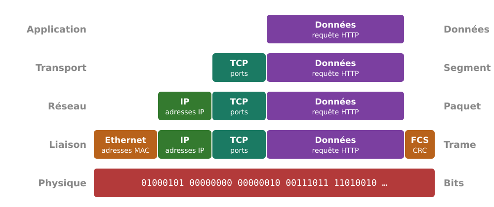
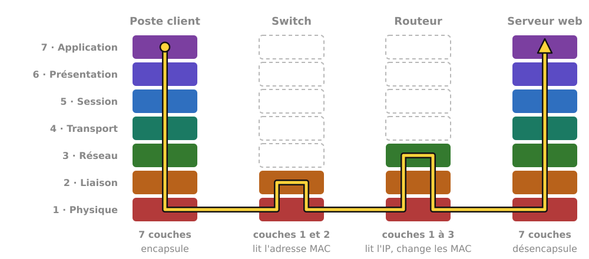
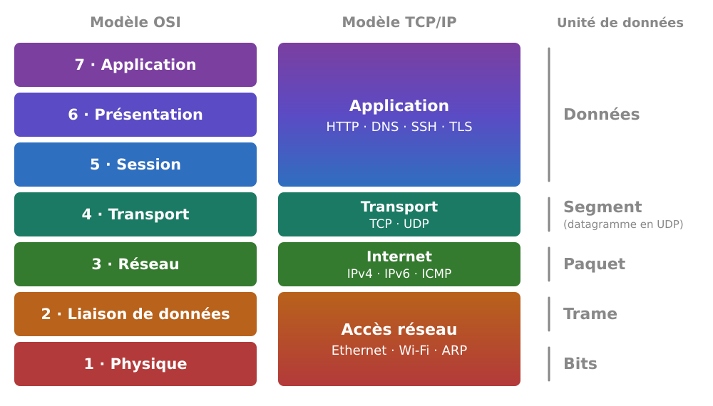
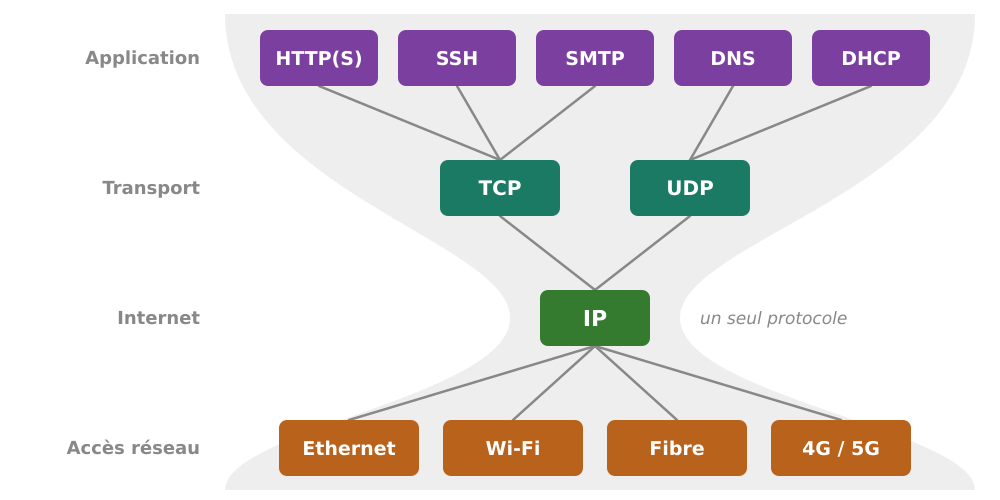
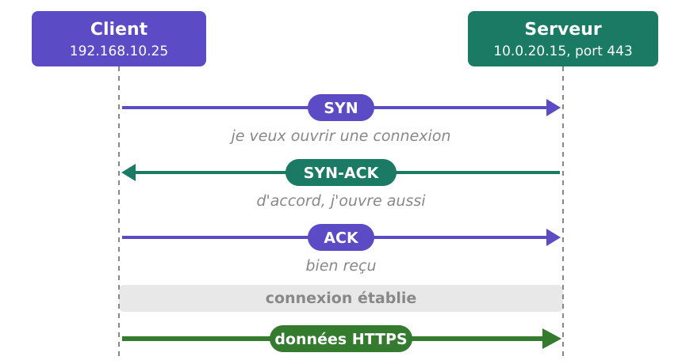

# Introduction au modèle OSI et à TCP/IP

### Les modèles en couches des réseaux

TSSR · AIS

<!-- Les réponses du quiz sont dans les notes des diapositives correspondantes. -->

---

## 🎯 Objectifs pédagogiques

À la fin de ce cours, vous saurez :

1. Expliquer pourquoi on décrit les réseaux **en couches**
2. Citer les **sept couches OSI**, dans l'ordre, avec leur rôle
3. Associer à chaque couche son **unité de données**, son **adresse**, ses **équipements**
4. Décrire l'**encapsulation**, du logiciel jusqu'au câble
5. Faire correspondre **TCP/IP** et **OSI**
6. Situer une **panne** ou une **attaque** sur la bonne couche

---

## Le parcours

| #  | Étape                                  |
|----|----------------------------------------|
| 1  | Pourquoi un modèle en couches ?        |
| 2  | Le modèle OSI, couche par couche       |
| 3  | L'encapsulation                        |
| 4  | Le modèle TCP/IP                       |
| 5  | Diagnostiquer et sécuriser par couche  |

---

# 1. Pourquoi des couches ?

---

## Le problème de l'interopérabilité

- Une page web fait intervenir un portable Windows, une borne Wi-Fi, un switch,
  un routeur, de la fibre, un serveur Linux, de **constructeurs différents**
- Dans les années 1970, chaque constructeur a **sa propre** architecture (SNA
  chez IBM, DECnet chez Digital) : deux marques ne peuvent pas communiquer
- Il faut des **règles communes** et publiques, que tous implémentent
- Une norme unique, du câble jusqu'au courriel, serait impossible à maintenir

> Solution : découper le problème en couches.

---

## Diviser pour régner

Chaque couche :

- a **une mission** précise
- **rend un service** à la couche du dessus
- **utilise le service** de la couche du dessous
- **dialogue avec la couche de même niveau** sur la machine distante, selon un **protocole**

Conséquences : on remplace le Wi-Fi par un câble **sans modifier le
navigateur**, un switch Cisco fonctionne avec un switch HPE, on **dépanne
couche par couche**.

---

## L'analogie : la directrice, l'interprète, le secrétariat

| Niveau      | Lyon                       | Osaka                         | Protocole commun        |
|-------------|----------------------------|-------------------------------|-------------------------|
| Dirigeants  | rédige en français         | lit en japonais               | l'accord commercial     |
| Interprètes | traduit en anglais         | traduit de l'anglais          | une langue commune      |
| Secrétariats| envoie le courriel         | reçoit le courriel            | le moyen d'envoi        |

- Chaque niveau a **son protocole** avec le niveau équivalent
- Chaque niveau **ignore le détail** des autres
- Seul le niveau le plus bas **transmet réellement** les données

<!-- Correspondances : secrétariat = carte réseau, interprète = TCP/IP,
     directrice = navigateur. Le dialogue des dirigeants est logique : les
     messages descendent la chaîne d'un côté et la remontent de l'autre. -->

---

## Protocole et service

| Terme         | Relation                                                      | Exemple                                |
|---------------|---------------------------------------------------------------|----------------------------------------|
| **Protocole** | *horizontale* : même niveau, deux machines                    | HTTP entre navigateur et serveur web   |
| **Service**   | *verticale* : deux couches voisines, même machine             | TCP offre à HTTP un transport fiable   |

Un protocole définit le **format** des messages, leur **ordre** et la
**réaction** attendue. Deux logiciels d'éditeurs différents communiquent s'ils
respectent le même protocole.

---

## Historique des deux modèles

| Année | Événement                                           |
|-------|-----------------------------------------------------|
| 1974  | Cerf et Kahn publient le principe de TCP            |
| 1981  | IP et TCP normalisés (RFC 791 et 793)               |
| 1983  | ARPANET bascule entièrement sur TCP/IP              |
| 1984  | L'ISO publie le modèle **OSI** (ISO 7498)           |
| 1989  | La RFC 1122 fixe les couches de **TCP/IP**          |

> OSI sert de **modèle de référence**, TCP/IP est la pile **réellement utilisée**.

<!-- TCP/IP a été construit à partir de protocoles déjà déployés ; ses normes
     (RFC) sont publiées gratuitement par l'IETF. OSI a été normalisé avant
     d'être implémenté : ses protocoles ont été peu adoptés, son vocabulaire
     est devenu la référence. Le réseau français Cyclades (Louis Pouzin) a
     introduit le datagramme repris par IP. -->

---

# 2. Le modèle OSI

---

## Les sept couches

| N° | Couche             | Rôle                                                  | Unité (PDU) |
|----|--------------------|-------------------------------------------------------|-------------|
| 7  | **Application**    | Services réseau pour les logiciels                    | Données     |
| 6  | **Présentation**   | Format commun : encodage, compression, chiffrement    | Données     |
| 5  | **Session**        | Ouvrir, maintenir, fermer un dialogue                 | Données     |
| 4  | **Transport**      | Acheminer de bout en bout, d'un programme à un autre  | Segment     |
| 3  | **Réseau**         | Acheminer entre réseaux : adresse IP, routage         | Paquet      |
| 2  | **Liaison**        | Acheminer sur le réseau local : adresse MAC           | Trame       |
| 1  | **Physique**       | Transmettre des bits sous forme de signal             | Bit         |

Numérotation **de bas en haut** : la couche 1 correspond au support physique,
la couche 7 à l'application.

---

## Retenir l'ordre

| 1            | 2           | 3          | 4             | 5           | 6                | 7                   |
|--------------|-------------|------------|---------------|-------------|------------------|---------------------|
| **P**hysique | **L**iaison | **R**éseau | **T**ransport | **S**ession | **P**résentation | **A**pplication     |
| **P**our     | **L**e      | **R**éseau | **T**out      | **S**e      | **P**asse        | **A**utomatiquement |

De 7 à 1, en anglais : **A**ll **P**eople **S**eem **T**o **N**eed **D**ata **P**rocessing

- Couches **1 à 3** : l'**acheminement**, dans les postes et les équipements traversés
- Couches **4 à 7** : **de bout en bout**, seulement chez le client et le serveur

---

## Couche 1 : Physique

**Transformer les bits en signal** électrique, lumineux ou radio.

- **PDU** : le bit
- **Adresse** : aucune
- **Matériel** : paire torsadée cat. 6, fibre, RJ45, modules SFP, hubs (obsolètes)
- **Normes** : 1000BASE-T, 10GBASE-SR, la partie radio du Wi-Fi

> Pannes courantes : voyant éteint, câble endommagé, fibre sale.

---

## Couche 2 : Liaison de données

**Faire circuler des trames sur le réseau local** et détecter les erreurs.

- **PDU** : la trame
- **Adresse** : MAC sur 48 bits, par exemple `3c:52:82:1a:f4:07`
- **Matériel** : switch, point d'accès Wi-Fi, carte réseau
- **Protocoles** : Ethernet (802.3), Wi-Fi (802.11), VLAN (802.1Q), STP

Le switch associe chaque **adresse MAC à un port** et envoie la trame
uniquement sur ce port. La trame **ne franchit pas le routeur**.

---

## Couche 3 : Réseau

**Acheminer des paquets d'un réseau à l'autre** : le routage.

- **PDU** : le paquet
- **Adresse** : IP, par exemple `192.168.10.25` (IPv4, 32 bits) ou `2001:db8::25` (IPv6, 128 bits)
- **Matériel** : routeur, switch de niveau 3, pare-feu
- **Protocoles** : IPv4, IPv6, ICMP (`ping`), OSPF, BGP

> L'adresse **MAC** identifie un équipement du réseau local, l'adresse **IP** la destination finale.

<!-- Le TTL diminue de 1 à chaque routeur : détaillé dans la partie 3. -->

---

## Couche 4 : Transport

**Acheminer de bout en bout, d'un programme à un autre.**

- **PDU** : le segment (TCP), le datagramme (UDP)
- **Adresse** : le **port** sur 16 bits (443 pour HTTPS, 22 pour SSH)
- **Matériel** : pare-feu (filtrage par port), répartiteur de charge
- **Protocoles** : TCP (fiable), UDP (léger)

IP + port = **socket** : `10.0.20.15:443` désigne le service HTTPS du serveur.

---

## Couches 5 et 6 : Session et Présentation

- **Session (5)** : ouvrir, synchroniser, fermer un dialogue (RPC, NetBIOS)
- **Présentation (6)** : forme des données (UTF-8, JPEG, compression, chiffrement)

En pratique, **les applications prennent en charge ces fonctions**.

→ TCP/IP les intègre à sa couche Application.

<!-- TLS est souvent classé en couche 6 ; en pratique il se situe entre
     transport et application. -->

---

## Couche 7 : Application

**Fournir aux logiciels les services réseau** : page web, courriel, résolution de noms, accès distant.

- **PDU** : les données (ou *message*)
- **Adresse** : nom de domaine, URL, adresse de courriel
- **Matériel** : proxy, WAF, pare-feu de nouvelle génération
- **Protocoles** : HTTP(S), DNS, DHCP, SMTP, IMAP, SSH, LDAP, RDP

> Firefox est une application : il **utilise** HTTP, protocole de couche 7.

---

## Jusqu'à quelle couche travaille chaque équipement ?

| Équipement                              | Couches | Il décide selon…                  |
|-----------------------------------------|---------|-----------------------------------|
| Hub                                     | 1       | rien : il répète le signal        |
| Switch, point d'accès Wi-Fi             | 1 → 2   | l'adresse MAC de destination      |
| Routeur, switch de niveau 3             | 1 → 3   | l'adresse IP de destination       |
| Pare-feu classique                      | 1 → 4   | adresses IP, protocole, ports     |
| Proxy, WAF, pare-feu nouvelle génération| 1 → 7   | le contenu : URL, application     |
| Poste, serveur                          | 1 → 7   | toutes les couches                |

---

# Pause

### Reprise avec l'encapsulation

---

# 3. L'encapsulation

---

## Encapsuler : chaque couche ajoute son en-tête

<style scoped>img { display: block; margin: 0 auto; }</style>



À l'arrivée, **désencapsulation** : chaque couche lit son en-tête et le retire.

<!-- En-tête Ethernet 14 octets + FCS 4, IP 20, TCP 20. Analogie : lettre dans
     une enveloppe, dans un colis, dans un camion. -->

---

## Le fil rouge

Un poste de l'accueil ouvre `https://intranet.example.com`

| Machine                              | Adresse IP       | Adresse MAC           |
|--------------------------------------|------------------|-----------------------|
| Poste de l'accueil                   | `192.168.10.25`  | `00:00:5e:00:53:25`   |
| Routeur, côté postes (la passerelle) | `192.168.10.254` | `00:00:5e:00:53:fe`   |
| Routeur, côté serveurs               | `10.0.20.254`    | `00:00:5e:00:53:01`   |
| Serveur intranet                     | `10.0.20.15`     | `00:00:5e:00:53:15`   |

Un switch relie le poste au routeur, qui relie les deux réseaux.

---

## Le trajet : chaque équipement remonte jusqu'à la couche utile

<style scoped>img { display: block; margin: 0 auto; }</style>



---

## Ce qui change à chaque routeur

| Champ            | Poste → routeur               | Routeur → serveur               |
|------------------|-------------------------------|---------------------------------|
| MAC source       | poste `…:53:25`               | routeur `…:53:01`               |
| MAC destination  | routeur `…:53:fe`             | serveur `…:53:15`               |
| IP source        | `192.168.10.25`               | `192.168.10.25`                 |
| IP destination   | `10.0.20.15`                  | `10.0.20.15`                    |
| TTL              | `128`                         | `127`                           |

> Les adresses **MAC** changent à chaque routeur, les adresses **IP** restent les mêmes (sauf NAT).

<!-- Valeur initiale du TTL : 128 sous Windows, 64 sous Linux. La NAT de la box
     remplace l'IP source privée par l'IP publique. -->

---

## ARP : trouver la MAC de la passerelle

1. `10.0.20.15` n'est **pas dans le réseau local** (d'après le masque)
2. Le poste passe donc par sa **passerelle** `192.168.10.254`
3. Il demande **l'adresse MAC** de la passerelle avec ARP

```text
Poste → tous (ff:ff:ff:ff:ff:ff)  Qui a 192.168.10.254 ?
Routeur → poste                   192.168.10.254 est à 00:00:5e:00:53:fe
```

Réponse conservée dans le **cache ARP** : `arp -a` (Windows), `ip neigh` (Linux).

---

## Ce que montre Wireshark

```text
Frame 42: 571 bytes on wire (4568 bits)
Ethernet II, Src: 00:00:5e:00:53:25, Dst: 00:00:5e:00:53:fe
Internet Protocol Version 4, Src: 192.168.10.25, Dst: 10.0.20.15
Transmission Control Protocol, Src Port: 51234, Dst Port: 443, Len: 517
Transport Layer Security
```

Une ligne par couche, **de bas en haut**, dans l'ordre de la désencapsulation.

14 (Ethernet) + 20 (IP) + 20 (TCP) + 517 (données) = **571 octets**

<!-- La MAC de destination est celle de la passerelle, pas celle du serveur. -->

---

# 4. Le modèle TCP/IP

---

## Quatre couches au lieu de sept

<style scoped>img { display: block; margin: 0 auto; }</style>



<!-- Décrit par la RFC 1122. En haut, les applications assurent les fonctions
     des couches 5 et 6 ; en bas, TCP/IP utilise les normes existantes
     (Ethernet, Wi-Fi) définies par l'IEEE. De nombreux manuels présentent un
     modèle à 5 couches, qui sépare la couche Accès réseau en Liaison et
     Physique. -->

---

## Le sablier : tout passe par IP

<style scoped>img { display: block; margin: 0 auto; }</style>



> Toutes les applications passent par IP, et IP fonctionne sur tous les supports.

---

## TCP ou UDP ?

| Critère      | TCP                                  | UDP                                    |
|--------------|--------------------------------------|----------------------------------------|
| Connexion    | ouverte avant, fermée après          | aucune                                 |
| Fiabilité    | accusés de réception, retransmission | aucune garantie                        |
| Ordre        | garanti                              | non garanti                            |
| En-tête      | 20 octets minimum                    | 8 octets                               |
| Usages       | web, courriel, SSH, fichiers, RDP    | DNS, DHCP, NTP, voix, visio, jeux      |

> Critère de choix : une donnée qui arrive **en retard** est-elle encore utile ?

<!-- Un fichier doit arriver complet : TCP. Une image de visio en retard est
     inutile : UDP. -->

---

## La poignée de main TCP

<style scoped>img { display: block; margin: 0 auto; }</style>



> Réponse `SYN-ACK` : port **ouvert** · `RST` : port **fermé** · aucune réponse : trafic **filtré**

<!-- Des milliers de SYN sans ACK final épuisent les ressources du serveur :
     c'est le SYN flood, vu en partie 5. -->

---

## Les ports courants

| Port   | Service         |   | Port   | Service              |
|--------|-----------------|---|--------|----------------------|
| 20, 21 | FTP             |   | 123    | NTP (UDP)            |
| 22     | SSH             |   | 143    | IMAP                 |
| 23     | Telnet ⚠️       |   | 161    | SNMP (UDP)           |
| 25     | SMTP            |   | 389    | LDAP                 |
| 53     | DNS (UDP, TCP)  |   | 443    | HTTPS                |
| 67, 68 | DHCP (UDP)      |   | 445    | SMB                  |
| 80     | HTTP            |   | 3389   | RDP                  |

Bien connus : **0 à 1023** · enregistrés : **1024 à 49151** · dynamiques : **49152 à 65535**

<!-- Telnet : administration non chiffrée, à proscrire. Le client utilise un
     port dynamique (51234 dans la capture Wireshark). -->

---

# 5. Sur le terrain

---

## Diagnostiquer de bas en haut

"L'intranet ne s'affiche pas" :

1. Le **lien** est-il actif ? → couche 1
2. Le poste a-t-il une **adresse IP** valide ? → couche 3
3. La **passerelle** répond-elle au ping ? → couches 2 et 3 locales
4. Le **serveur** répond-il au ping ? → couche 3, routage
5. Le **nom** se résout-il ? → couche 7, DNS
6. Le **port 443** est-il ouvert ? → couche 4, pare-feu, service
7. Sinon → couche 7 : application, certificat, droits

> `ping` teste les couches 1 à 3 en une seule commande.

---

## Les commandes par couche

| Couche | Question                     | Windows                        | Linux                  |
|--------|------------------------------|--------------------------------|------------------------|
| 1      | Lien actif ?                 | `Get-NetAdapter`               | `ip link`              |
| 2      | Voisins connus ?             | `arp -a`                       | `ip neigh`             |
| 3      | Adresse, passerelle ?        | `ipconfig /all`                | `ip addr`, `ip route`  |
| 3      | Joignable ? Par où ?         | `ping`, `tracert`              | `ping`, `traceroute`   |
| 4      | Port ouvert ?                | `Test-NetConnection -Port 443` | `nc -zv hôte 443`      |
| 4      | Ports en écoute ?            | `netstat -ano`                 | `ss -tulpn`            |
| 7      | Nom résolu ?                 | `Resolve-DnsName`              | `dig`                  |
| 7      | Service web ?                | `curl.exe -I`                  | `curl -I`              |

<!-- Attention : dans Windows PowerShell 5.1, curl est un alias de
     Invoke-WebRequest. Utiliser curl.exe. -->

---

## Attaques et contre-mesures par couche

| Couche | Attaques                                   | Contre-mesures                                 |
|--------|--------------------------------------------|------------------------------------------------|
| 1      | prise pirate, écoute, brouillage radio     | accès aux locaux et baies, prises désactivées  |
| 2      | usurpation ARP, saturation MAC, faux DHCP  | sécurité des ports, 802.1X, DAI, DHCP snooping |
| 3      | usurpation IP, balayage, DDoS              | ACL, pare-feu, cloisonnement                   |
| 4      | SYN flood, balayage de ports               | pare-feu à états, SYN cookies                  |
| 5-6    | vol de session, TLS obsolète               | TLS 1.2 minimum, 1.3 de préférence             |
| 7      | hameçonnage, injection SQL, force brute    | mises à jour, WAF, MFA, sensibilisation        |

> **Défense en profondeur** : protéger chaque couche.

---

## Un pare-feu, mais de quelle couche ?

| Type                                   | Couches lues         | Il décide selon…                         |
|----------------------------------------|----------------------|------------------------------------------|
| Filtrage sans état (ACL)               | 3 et 4               | IP, protocole, ports, paquet par paquet  |
| Pare-feu à états                       | 3 et 4 + connexions  | idem, et l'état de la connexion          |
| Proxy, WAF, nouvelle génération        | jusqu'à 7            | URL, application, utilisateur, contenu   |

Plus il analyse de couches, plus ses règles sont **précises**, mais il doit
**déchiffrer** le trafic TLS pour lire le contenu.

> Un pare-feu de couches 3 et 4 ne détecte pas une usurpation ARP (couche 2).

---

## Quiz (1/2)

1. Quelle couche utilise les adresses MAC ?
2. Sur quelle adresse un routeur fonde-t-il sa décision ?
3. PDU de la couche 4 avec TCP ? De la couche 3 ?
4. Les sept couches, de 1 à 7 ?
5. `ping 10.0.20.15` répond, le site ne s'affiche pas : quelles couches
   fonctionnent ? Que vérifier ensuite ?

<!-- Réponses :
     1. Couche 2, Liaison.
     2. L'adresse IP de destination.
     3. Segment ; paquet.
     4. Physique, Liaison, Réseau, Transport, Session, Présentation,
        Application.
     5. Les couches 1 à 3 fonctionnent jusqu'au serveur. Vérifier le DNS
        (couche 7), le port 443 (couche 4), puis le service web (couche 7). -->

---

## Quiz (2/2)

6. Transport et port d'une requête DNS ordinaire ?
7. Quelles couches OSI la couche Application de TCP/IP regroupe-t-elle ?
8. Au passage d'un routeur, qu'est-ce qui change : MAC, IP, TTL ?
9. L'usurpation ARP : quelle couche ? Quelle contre-mesure ?
10. Un filtre d'adresses et de ports bloque-t-il une injection SQL ?

<!-- Réponses :
     6. UDP, port 53 (TCP 53 pour les réponses volumineuses et les transferts
        de zone).
     7. Couches 5, 6 et 7.
     8. MAC source et destination réécrites, TTL diminué de 1 ; IP inchangées
        sauf NAT.
     9. Couche 2 ; DAI, 802.1X, segmentation en VLAN.
     10. Non : l'injection se trouve dans le contenu HTTP, en couche 7. Il faut
         un WAF. -->

---

## Pour aller plus loin

- [RFC 1122](https://www.rfc-editor.org/rfc/rfc1122) : les couches TCP/IP côté hôte
- [UIT-T X.200](https://www.itu.int/rec/T-REC-X.200) : le modèle OSI, en accès libre
- [Wireshark](https://www.wireshark.org/) : observer les couches sur de vraies trames
- [FrameIP](https://www.frameip.com/) : les en-têtes des protocoles, champ par champ
- [Cisco Networking Academy](https://www.netacad.com/) : Packet Tracer, l'encapsulation étape par étape
- [ANSSI](https://cyber.gouv.fr/) : guides de sécurisation des réseaux

---

# Des questions ?
